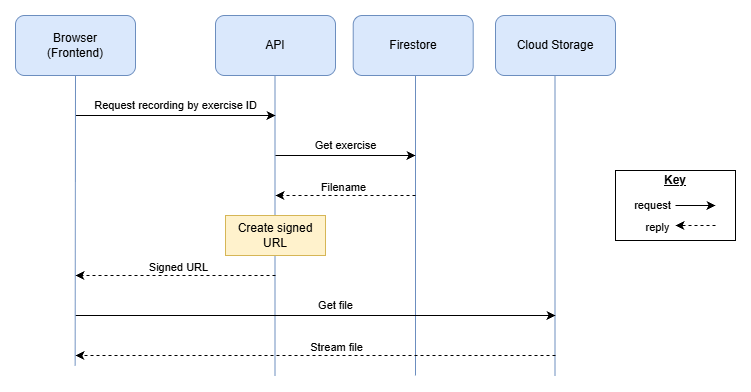

**Scottish Sounds**  
**API Design 1.0**  
Bruce Gray & Sergio Eneide  
04/11/2026

Status: Draft. Bruce has written the shared rules and the recordings sections. Sergio will add the exercises and answer checking part. The document is subject to change at this stage.

**1. Scope**

This covers the API for the MVP in the SRS v1.1. The MVP has no user accounts, so there's no login. The API is a Node.js + TypeScript app on Google Cloud Run. It reads exercises from Firestore and gives the frontend links to recordings stored in a private Cloud Storage bucket (a bucket is just a folder in the cloud that holds files). The API, Firestore and Cloud Storage are all hosted in London (europe-west2) on Google Cloud.

**2. Shared Rules**

These are suggestions for both halves to follow:

- All routes start with `/api/v1/` so it's clear which requests go to the API, and if we ever make breaking changes we can add `/api/v2/` without breaking the existing frontend
- Use plural nouns for routes, e.g. `/exercises`
- Requests and responses are JSON, over HTTPS only
- Errors always look like `{ "error": "Exercise not found" }` with the right status code (400, 404, 429, 500 or 503)
- Code is split into routes → controllers → services → database or storage, so each part has one job

**3. Recordings**

| Method | Route                                                     | What it does                                                                |
|--------|-----------------------------------------------------------|-----------------------------------------------------------------------------|
| GET    | `/api/v1/exercises/{exerciseId}/recording?mode=video` | Returns a link to the exercise's video (MP4)                                |
| GET    | `/api/v1/exercises/{exerciseId}/recording?mode=audio` | Returns a link to the audio only (MP3), which uses less mobile data (US-02) |
| GET    | `/api/v1/health`                                          | Returns `{ "status": "ok" }` if the API is running                      |

`/health` lets us monitor uptime, supporting NFR-04 (uptime requirement) and NFR-06 (deploying without downtime).

**Example response:**

```json
{ "url": "https://storage.googleapis.com/...", "mimeType": "video/mp4", "expiresAt": "2026-11-04T17:30:00Z" }
```

**How it works (Sequence Diagram)**



The bucket is private, so the API creates a signed URL that only works for about 10 minutes. The browser then plays the file straight from Cloud Storage, so large files don't go through the API. If the link runs out, the frontend just asks for a new one.

**Storage adapter**

Only one class in the API talks to Cloud Storage. The rest of the code calls this class, so if we ever change storage provider we only need to change that one class. This is the Adapter design pattern.

**Security**

- The bucket is private and links expire, so recordings can't be shared or scraped with permanent links
- The browser only sends an exercise ID, never a file path, so users can't request other files
- If a speaker withdraws consent, their files are deleted and any old links stop working (Risk Register RH-2)
- The API uses its Cloud Run service account with read-only access and no key files, so there are no keys to leak (RH-8)
- Rate limiting stops people spamming requests and running up costs

**4. Exercises & Answer Checking**

To be added: getting exercises by difficulty level, checking answers, revealing the answer and moving to the next exercise.

**5. OpenAPI**

OpenAPI is a standard way of describing an API in a YAML or JSON file, which tools like Swagger UI can turn into interactive docs (OpenAPI Initiative, n.d.). Once both halves are agreed, we could write one for the whole API before development starts.

**6. References**

OpenAPI Initiative (n.d.) *What is OpenAPI?* \[online\]. Available from <https://www.openapis.org/what-is-openapi> \[4th Nov 2026\]

Scottish Sounds Team (2026) *System Requirements Specification v1.1*. Unpublished internal document.

Scottish Sounds Team (2026) *Risk Register v1.0*. Unpublished internal document.
