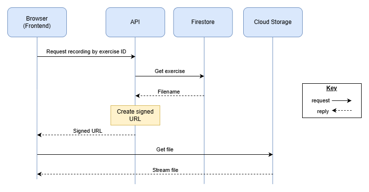

**Scottish Sounds**  
**API Design 1.1**  
Bruce Gray & Sergio Eneide  
12/11/2026

**1. Scope**

This covers the API for the MVP in the SRS v1.1. The MVP has no user accounts, so there's no login. The API is a Node.js + TypeScript app on Google Cloud Run. It reads exercises from Firestore and gives the frontend links to recordings stored in a private Cloud Storage bucket (a bucket is just a folder in the cloud that holds files). The API, Firestore and Cloud Storage are all hosted in London (europe-west2) on Google Cloud.

**2. Shared Rules**

These are suggestions for both halves to follow:

- All routes start with `/api/v1/` so it's clear which requests go to the API, and if we ever make breaking changes we can add `/api/v2/` without breaking the existing frontend
- Use plural nouns for routes, e.g. `/exercises`
- Requests and responses are JSON, over HTTPS only
- Errors always look like `{ "error": "Exercise not found" }` with the right status code (400, 404, 429, 500 or 503)
- Code is split into routes → controllers → services → database or storage, so each part has one job

**3. Recordings**

| Method | Route                                                     | What it does                                                                |
|--------|-----------------------------------------------------------|-----------------------------------------------------------------------------|
| GET    | `/api/v1/exercises/{exerciseId}/recording?mode=video`     | Returns a link to the exercise's video (MP4)                                |
| GET    | `/api/v1/exercises/{exerciseId}/recording?mode=audio`     | Returns a link to the audio only (MP3), which uses less mobile data (US-02) |
| GET    | `/api/v1/health`                                          | Returns `{ "status": "ok" }` if the API is running                      |

`/health` lets us monitor uptime, supporting NFR-04 (uptime requirement) and NFR-06 (deploying without downtime).

**Example response:**

```json
{ "url": "https://storage.googleapis.com/...", "mimeType": "video/mp4", "expiresAt": "2026-11-04T17:30:00Z" }
```

**How it works (Sequence Diagram)**



The bucket is private, so the API creates a signed URL that only works for about 10 minutes. The browser then plays the file straight from Cloud Storage, so large files don't go through the API. If the link runs out, the frontend just asks for a new one.

**Storage adapter**

Only one class in the API talks to Cloud Storage. The rest of the code calls this class, so if we ever change storage provider we only need to change that one class. This is the Adapter design pattern.

**Security**

- The bucket is private and links expire, so recordings can't be shared or scraped with permanent links
- The browser only sends an exercise ID, never a file path, so users can't request other files
- If a speaker withdraws consent, their files are deleted and any old links stop working (Risk Register RH-2)
- The API uses its Cloud Run service account with read-only access and no key files, so there are no keys to leak (RH-8)
- Rate limiting stops people spamming requests and running up costs

**4. Exercises & Answer Checking**

| Method | Route                                                     | What it does                                                                |
|--------|-----------------------------------------------------------|-----------------------------------------------------------------------------|
| GET    | `/api/v1/exercises?level=1`                               | Returns the exercises at the chosen difficulty level (US-01)                |
| GET    | `/api/v1/exercises/{exerciseId}`                          | Returns one exercise's details |
| POST   | `/api/v1/exercises/{exerciseId}/check`                    | Checks the student's answer and says which characters are right or wrong (US-05) |
| GET    | `/api/v1/exercises/{exerciseId}/answer`                   | Returns the correct answer when the student clicks reveal (US-06) |

The answer is never included when exercises are fetched. It only leaves the API through the check and reveal routes, so students can't find it in the browser's dev tools.

**Checking an answer**

The frontend sends the student's answer:

`{ "answer": "lɔk" }`

The API compares it with the correct answer stored in Firestore, character by character, and sends back which ones are right. Here the correct answer is /lɔx/, so the final character is marked wrong:

`{ "correct": false, "correctCount": 2, "totalCount": 3, "characters": [ { "char": "l", "correct": true }, { "char": "ɔ", "correct": true }, { "char": "k", "correct": false } ] }`

The frontend uses this to show how many characters were correct and mark the wrong ones (FR-05, FR-06).

Before comparing, the API cleans up both answers by removing extra spaces and putting the IPA symbols into the same Unicode format. That way, a symbol typed in a slightly different way isn't marked incorrect. Diacritics are checked together with the letter they belong to, not as separate characters. If an exercise has more than one accepted answer, the API compares against each one and uses the closest match.

If the answer is empty or too long, the API returns 400.

**Revealing the answer**

The reveal button only appears after the student has checked at least one answer (US-06). The frontend handles this, because the MVP has no accounts, so the API can't track who has attempted what.

**Next exercise**

The frontend already has the list of exercises from the first route, so it just loads the next one and clears the previous answer and feedback (US-07). No extra route is needed here.

**5. Monitoring & Logging**

Cloud Run tracks API calls automatically, so we don't need to build our own tracking:

- **Request logs:** every request to the API is logged in Google Cloud Logging, including the route, the status code, how long the response took, and the user's IP address.
- **Metrics:** Cloud Monitoring shows graphs of request count and response times for the API. These are built in, with no extra setup and no charge on Cloud Run.
- **Uptime checks:** Cloud Monitoring can call `/health` regularly and send an alert (e.g. an email) if it fails. This gives us the monitoring data needed to verify NFR-04 (99% monthly uptime).
- **Our own logs:** the API can also write its own messages, e.g. when a signed URL couldn't be created. Anything it prints is sent to Cloud Logging automatically, which helps with debugging and testing.

**Privacy:** request logs include IP addresses, which count as personal data under UK GDPR. So:

- **Retention:** Cloud Logging keeps logs for 30 days by default, and this can be shortened.
- **Location:** logs aren't stored in London by default, so the API's logs should go to a log bucket in europe-west2 to stay in London with the rest of the system.

Tracking students' answers is out of scope for the MVP, as there are no user accounts, but it could be considered once accounts are added.

**6. OpenAPI**

OpenAPI is a standard way of describing an API in a YAML or JSON file, which tools like Swagger UI can turn into interactive docs (OpenAPI Initiative, n.d.). Once the design is agreed, we could write one for the whole API before development starts.

**7. References**

Google Cloud (n.d.) *Logging and viewing logs in Cloud Run* \[online\]. Available from <https://docs.cloud.google.com/run/docs/logging> \[10th Nov 2026\]

Google Cloud (n.d.) *Monitoring Cloud Run* \[online\]. Available from <https://docs.cloud.google.com/run/docs/monitoring> \[10th Nov 2026\]

OpenAPI Initiative (n.d.) *What is OpenAPI?* \[online\]. Available from <https://www.openapis.org/what-is-openapi> \[4th Nov 2026\]

Scottish Sounds Team (2026) *System Requirements Specification v1.1*. Unpublished internal document.

Scottish Sounds Team (2026) *Risk Register v1.0*. Unpublished internal document.