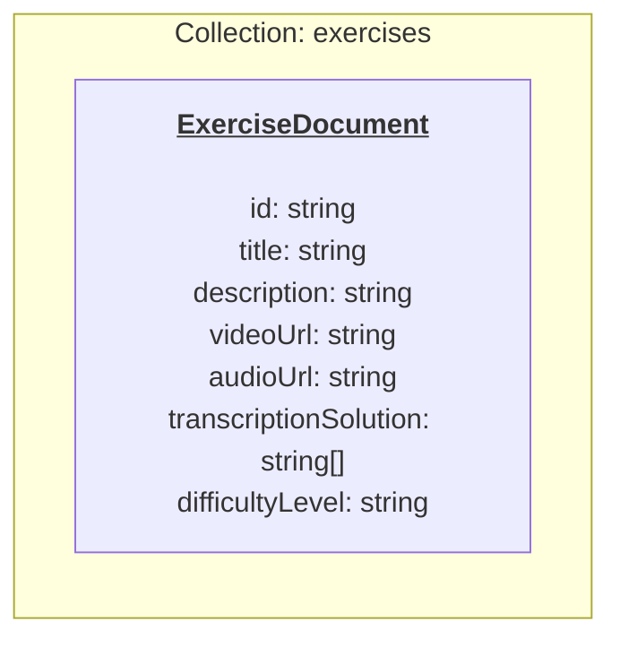
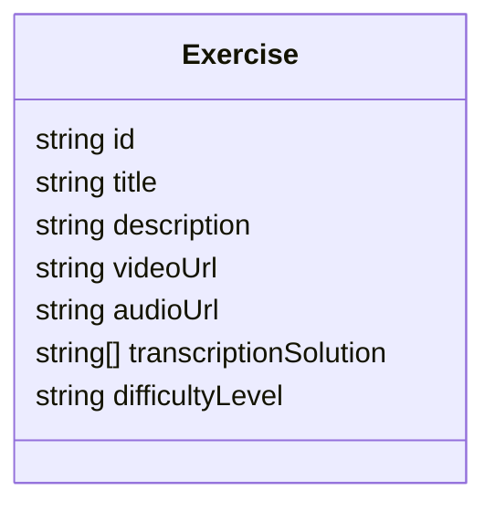
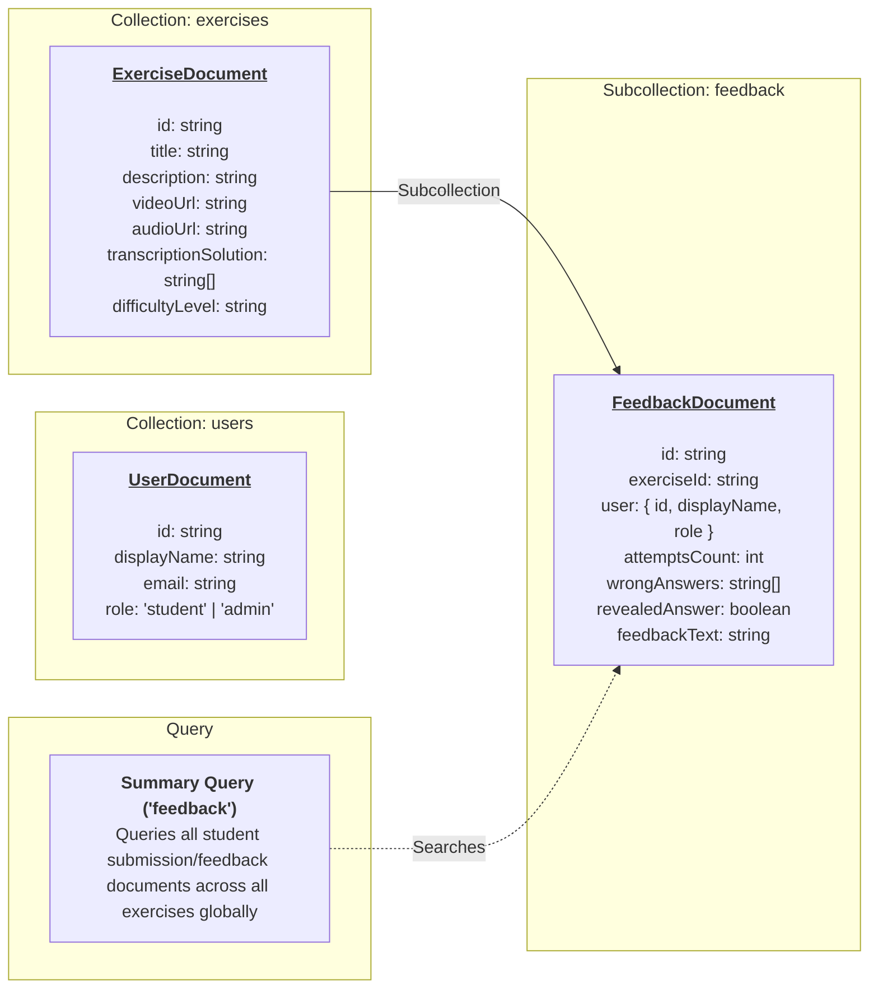

<!-- First Iterations -->

# First Iterations

### Flowchart



<!-- First Iterations -->
### Class Diagram


    
    
<!-- Future Iterations -->
# Future Iterations

### Flowchart


### Class Diagram

``` mermaid

classDiagram
    class User {
        string id
        string displayName
        string email
        string role
    }
    class Exercise {
        string id
        string title
        string description
        string videoUrl
        string audioUrl
        string[] transcriptionSolution
        string difficultyLevel
        
    }
    class Feedback {
        string id
        string exerciseId
        Object user
        int attemptsCount
        string[] wrongAnswers
        boolean revealedAnswer
        string feedbackText
    }
    Exercise  -->  Feedback : subcollection
    ```

 